<picture>
  <source media="(max-width: 600px) and (prefers-reduced-motion: reduce)" srcset="assets/feel-profile-mobile-still.svg">
  <source media="(prefers-reduced-motion: reduce)" srcset="assets/feel-profile-still.svg">
  <source media="(max-width: 600px)" srcset="assets/feel-profile-mobile.svg">
  
</picture>

<a href="https://github.com/elephancy/TypeShift"><picture><source media="(max-width: 600px)" srcset="assets/index-typeshift-mobile.svg">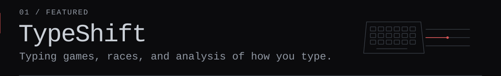</picture></a>
 
<a href="https://github.com/elephancy/Doompedia"><picture><source media="(max-width: 600px)" srcset="assets/index-doompedia-mobile.svg">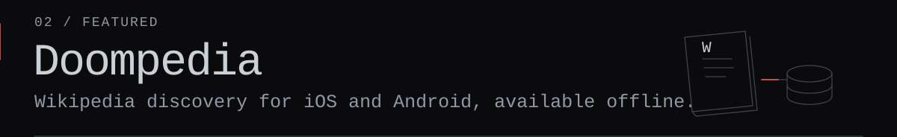</picture></a>

<picture></picture>
 
<a href="https://github.com/elephancy/Planora"><picture><source media="(max-width: 600px)" srcset="assets/index-planora-mobile.svg">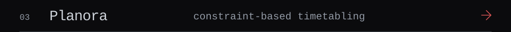</picture></a> 
<a href="https://github.com/elephancy/SystemForge"><picture><source media="(max-width: 600px)" srcset="assets/index-systemforge-mobile.svg">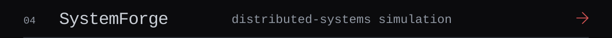</picture></a> 
<a href="https://github.com/elephancy/MANTA"><picture><source media="(max-width: 600px)" srcset="assets/index-manta-mobile.svg">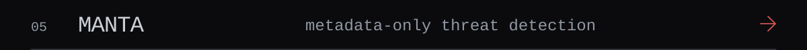</picture></a>

<picture></picture>
 
<a href="https://github.com/elephancy/RPS"><picture><source media="(max-width: 600px)" srcset="assets/index-rps-mobile.svg">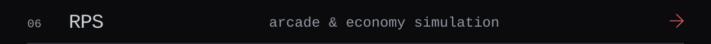</picture></a> 
<a href="https://github.com/elephancy/Anubis"><picture><source media="(max-width: 600px)" srcset="assets/index-anubis-mobile.svg">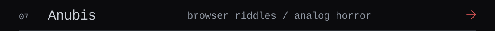</picture></a> 
<a href="https://github.com/elephancy/Gems"><picture><source media="(max-width: 600px)" srcset="assets/index-gems-mobile.svg">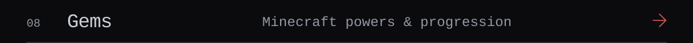</picture></a>

<picture></picture>
 
<a href="https://github.com/elephancy/Commit"><picture><source media="(max-width: 600px)" srcset="assets/index-commit-mobile.svg">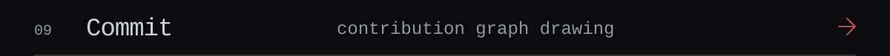</picture></a> 
<a href="https://github.com/elephancy/Portfolio"><picture><source media="(max-width: 600px)" srcset="assets/index-portfolio-mobile.svg">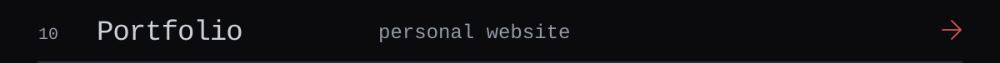</picture></a>

<a href="https://elfeel.me"><picture><source media="(max-width: 600px)" srcset="assets/index-portfolio-link-mobile.svg">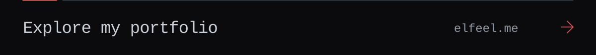</picture></a>

