<picture>
  <source media="(max-width: 600px) and (prefers-reduced-motion: reduce)" srcset="assets/feel-profile-mobile-still.svg">
  <source media="(prefers-reduced-motion: reduce)" srcset="assets/feel-profile-still.svg">
  <source media="(max-width: 600px)" srcset="assets/feel-profile-mobile.svg">
  
</picture>

**[TypeShift](https://github.com/elephancy/TypeShift)** · **[Doompedia](https://github.com/elephancy/Doompedia)**

[Planora](https://github.com/elephancy/Planora) · [SystemForge](https://github.com/elephancy/SystemForge) · [RPS](https://github.com/elephancy/RPS) · [MANTA](https://github.com/elephancy/MANTA) · [Anubis](https://github.com/elephancy/Anubis) · [Gems](https://github.com/elephancy/Gems) · [Commit](https://github.com/elephancy/Commit) · [Portfolio](https://github.com/elephancy/Portfolio)

[elfeel.me](https://elfeel.me)
